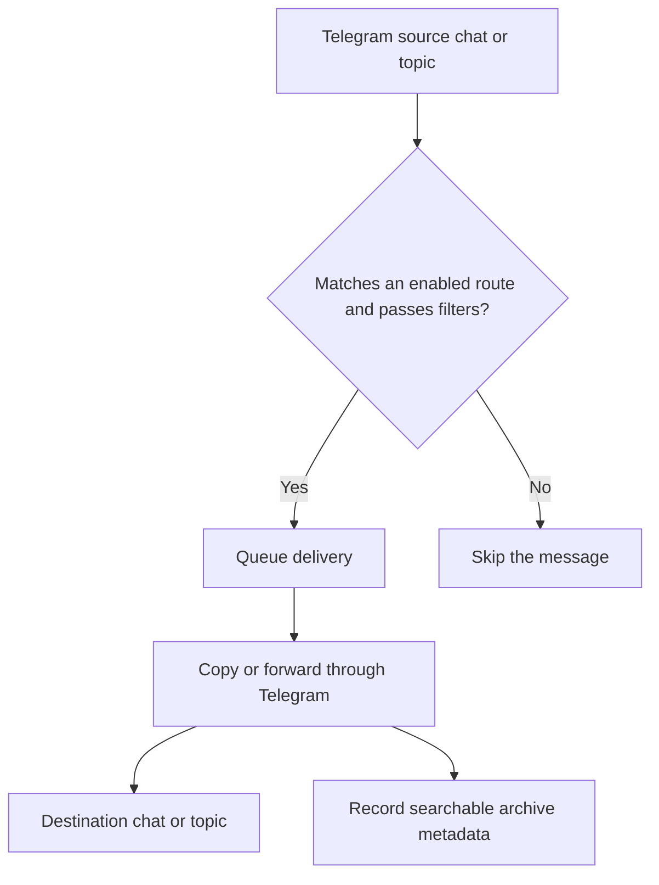

# OrbitSuite

**Forward Telegram posts, save them by link, and organize them in a searchable archive.**

OrbitSuite is a self-hosted Telegram bot for groups, channels, and forum topics. Route new posts using your own filters, save individual messages, and queue batches of known message IDs. Run it with Node.js and SQLite on your PC or server, or use Cloudflare Workers and D1.

[Quick start](#quick-start) · [Deployment options](#deployment-options) · [Full feature inventory](docs/FEATURES.md) · [MIT license](LICENSE)

## 🔄 How messages move



The bot stores route rules, job state, and archive metadata in SQLite or D1. Telegram handles ordinary copies and forwards directly. The optional media worker uses temporary disk space for downloads and conversions.

## ✨ Features

| Area | What you can do | Requirements |
| --- | --- | --- |
| 🔀 **Forwarding** | Copy or forward new posts between chats and topics. Filter by file type, keywords, sender, file size, MIME type, extension, date, or delivery window. Set captions, preserve albums, and optionally mirror replies, edits, and topic changes. | Bot access and permissions in the source and destination |
| 🗂️ **Archive and batch jobs** | Save individual posts by link. Search archive metadata by filename, caption, tag, type, chat, topic, or date. Export or import archive metadata and route settings. Process up to 10,000 known IDs with `/routebatch`, or up to 50 with `/batchlinks`. | A configured destination for link saves and access to the source |
| 🎞️ **Media tools** | Queue downloads from allowed sites, extract MP3s, transcode video, generate thumbnails, embed subtitles, and split or join files. View progress and job status in Telegram. | Optional [Python media worker](services/media_worker/README.md) with yt-dlp and FFmpeg. Telegram transfer limits apply. |
| 🕰️ **History import** | Preview a range of accessible older messages, filter by topic, and copy selected messages into an archive. The bridge defaults to a dry run and supports encrypted session storage. | Optional [local Pyrogram bridge](services/user_bridge/README.md) with a separate account login |
| 🛡️ **Moderation** | Pin or delete selected messages, ban or mute members, set auto-replies and anti-spam rules, and send announcements to opted-in subscribers. Supported delegated moderator actions enforce daily quotas. | Opt in and grant the relevant Telegram permissions |
| 🧰 **Personal tools** | Keep notes, set reminders, use aliases, and create private polls and forms. Add RSS, lookup, AI-assisted text tagging, or audio transcription. | Some tools need an optional [RSS and lookup service](services/automation/README.md), Ollama, or [local Whisper](services/ai/README.md). |
| 📊 **Dashboard and operations** | View read-only status, jobs, and routes in the dashboard or Telegram Mini App. Use cooldowns, send caps, job review, owner alerts, and SQLite backups. | The [dashboard](apps/dashboard/README.md) is opt-in. The Mini App needs public HTTPS. |

## 📚 Example · Build an SSC CGL PDF archive

Send `/id` in both Telegram topics to get their chat and topic IDs. Then send these commands in your private chat with the bot, replacing the example IDs with yours.

```text
/route -1001234567890 12 -1009876543210 34 pdf copy
/checkroute 1
/filter 1 include SSC CGL
```

This copies new PDFs whose captions contain `SSC CGL` from source topic `12` to destination topic `34`. Use the route ID returned by `/route` in place of `1`. To apply the filter before any live forwarding, use a quiet test source while configuring the route.

| Command | What it does |
| --- | --- |
| `/id` | Shows the chat and topic IDs |
| `/routes` | Lists your routes and their IDs |
| `/setarchive` and `/save` | Set an archive destination and save a single Telegram post by link |
| `/library` and `/find SSC CGL` | Browse recent archive entries or search their metadata |
| `/jobs` | Shows queued batch work |
| `/stop` and `/run` | Pause or resume processing. An in-flight request may still finish. |

[More commands and route examples](docs/DEPLOY.md#b-set-up-telegram-routes)

## Quick start

Install Node.js 24 or later and create a bot with BotFather. In PowerShell, from the repository root:

```powershell
Copy-Item .env.example .env
notepad .env
```

Set `BOT_TOKEN` to the BotFather token, `OWNER_ID` to your numeric Telegram user ID, and `WEBHOOK_SECRET` to a random private value of at least 16 characters. Keep `.env` private. The default polling mode requires outbound access to Telegram and a bot with no active webhook.

```powershell
node --env-file=.env apps/local/src/runtime.js
```

In a second PowerShell window, run `Invoke-RestMethod http://127.0.0.1:8787/readyz`. Then send `/id` from the owner account to check Telegram delivery. Add the bot to the source and destination chats with the permissions your route needs.

### Deployment options

| Where to run it | Setup |
| --- | --- |
| **Windows, Linux, or a VPS** | [Run Node.js with SQLite](docs/SELF_HOST.md) |
| **Docker** | [Use Docker Compose](docs/SELF_HOST.md#docker-compose-linux-pc-oracle-vm-or-any-docker-vps) and enable the media profile if needed |
| **Cloudflare** | [Deploy the Worker with D1 and a Telegram webhook](docs/DEPLOY.md) |
| **Other setups** | [Termux, systemd, Windows Task Scheduler, PostgreSQL, and Redis](infra/OPERATIONS.md) |

## 🧪 Verification and limits

- The v4.2 report records **171 passing offline tests**. The Node.js and SQLite runtime passed local startup and database readiness checks. Follow the [Windows staging guide](docs/WINDOWS_11_LIVE_TEST.md) and [acceptance checklist](docs/WINDOWS_11_ACCEPTANCE_CHECKLIST.md) for live Telegram checks.
- Routing and the history bridge skip protected content. History import requires the separate local bridge. Larger media jobs depend on the Bot API mode, file-size limits, and available temporary disk space.
- Payment and subscription plans are draft interfaces. See the [117-item ledger](docs/117_FEATURE_LEDGER.md) and [remaining acceptance gaps](docs/20_REMAINING_ACCEPTANCE_GAPS.md) for implementation and test status.

Run offline checks on Windows with `infra/windows/test-offline.ps1`, or follow the commands in the [CI workflow](.github/workflows/verify.yml). See [security and privacy](docs/SECURITY.md) for session, credential, and media handling.

## 📁 Repository and license

The shared bot logic lives in [`apps/worker`](apps/worker), the self-hosted Node runtime in [`apps/local`](apps/local), and optional services in [`services`](services). [`third_party`](third_party) contains archived upstream projects with their own licenses and attribution.

Maintained by [premchadda](https://github.com/premchadda). Original OrbitSuite code and documentation use the [MIT License](LICENSE). See the [upstream notices](legal/THIRD_PARTY_NOTICES.md) and [public source inventory](legal/PUBLIC_MIRROR_SCOPE.md) for third-party material.
